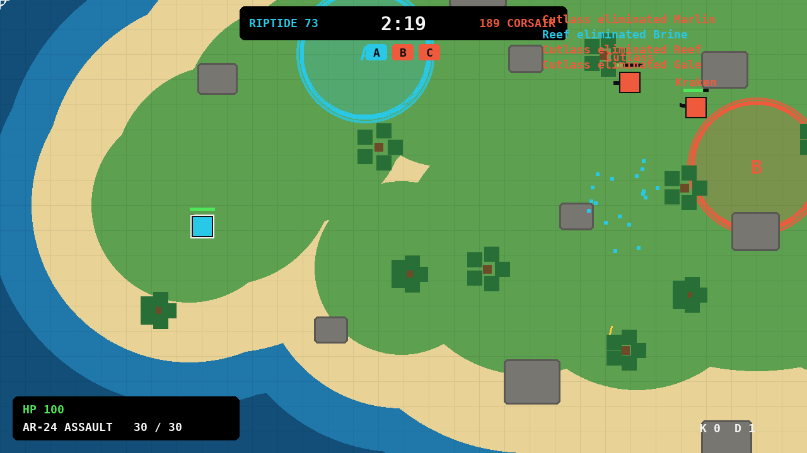
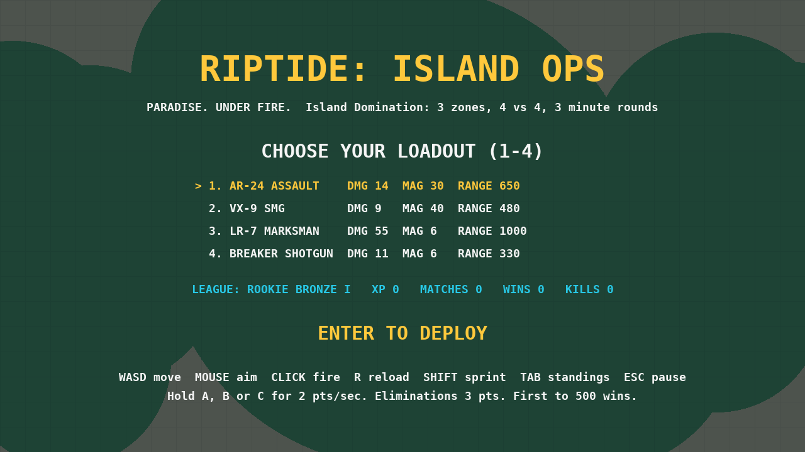
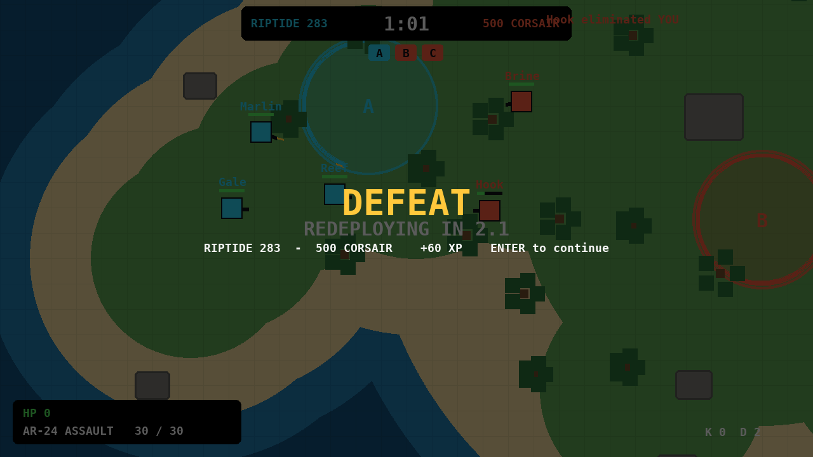

# Riptide: Island Ops

A top-down 4v4 island capture-zone shooter built in Python with Pygame, by Gerald Glispie (GAM125, University of Advancing Technology).

Team RIPTIDE (you + 3 bots) vs Team CORSAIR (4 bots). Hold zones A, B and C: each held zone scores 2 points a second, and each elimination scores 3. First to 500 points, or the higher score when the 3:00 clock runs out, wins.



## Run it (about 2 minutes)

1. Install Python 3.9 or newer from python.org.
2. Download this project: click the green **Code** button above, then **Download ZIP**, and unzip it.
3. Open a terminal in the unzipped folder and run:

```
pip install -r requirements.txt
python riptide_ops.py
```

## Controls

| Action | Key |
|---|---|
| Move | W A S D |
| Aim / fire | Mouse / left click |
| Reload | R |
| Sprint | Shift |
| Standings | Tab |
| Pause | Esc |
| Pick loadout (menu) | 1 to 4 |
| Deploy | Enter |

## Features

- Four loadouts to choose from on the menu
- Bot teammates and opponents that fight over the three zones
- Career save (XP, wins, rank) in `riptide_career.json`

## Screenshots



